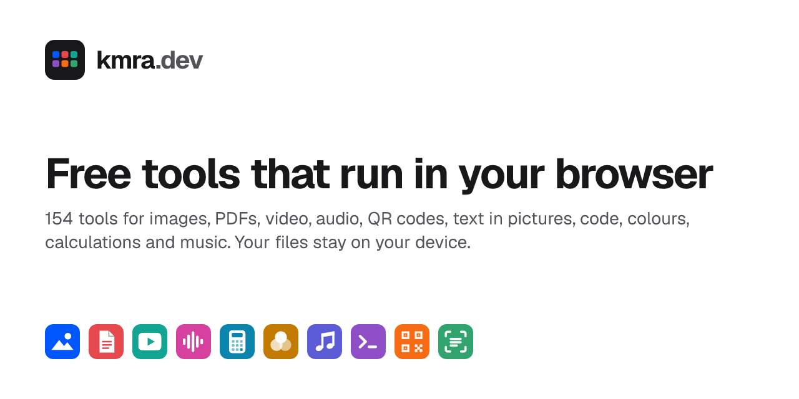

<p align="center">
  <a href="https://kmra.dev"></a>
</p>

<h1 align="center">kmra.dev</h1>

<p align="center">
  Free tools for images, PDFs, video, audio, QR codes, text in pictures, code, colours,
  calculations and music. Everything runs in your browser, so your files stay on your device.
</p>

<p align="center">
  <a href="https://kmra.dev"><b>kmra.dev</b></a> ·
  <a href="docs/README.md">Docs</a> ·
  <a href="CONTRIBUTING.md">Contributing</a> ·
  <a href="LICENSE">AGPL-3.0</a>
</p>

---

## The sites

Each kind of tool has its own site. [kmra.dev](https://kmra.dev) brings them together: drop any
file there and it suggests the tools that can open it.

| Site                                    | What it does                                                                          | Tools |
| --------------------------------------- | ------------------------------------------------------------------------------------- | ----: |
| [ImgTool](https://imgtool.kmra.dev)     | Compress, resize, convert, crop, cut out backgrounds, passport photos, strip metadata |    30 |
| [PDFTool](https://pdftool.kmra.dev)     | Merge, split, compress, sign, rotate, PDF to images and back                          |    14 |
| [VidTool](https://vidtool.kmra.dev)     | Compress, convert, trim, video to GIF or MP3, screen recorder                         |    14 |
| [AudioTool](https://audiotool.kmra.dev) | Convert, trim, join, change volume and speed, voice recorder                          |    15 |
| [QRTool](https://qrtool.kmra.dev)       | QR codes for links, Wi-Fi, contacts and payments; barcodes; scanners                  |     9 |
| [OCRTool](https://ocrtool.kmra.dev)     | Copy text from images, screenshots and scanned PDFs; searchable PDFs                  |     4 |
| [DevTool](https://devtool.kmra.dev)     | JSON, YAML, CSV, Base64, JWT, hashes, regex, diff and more                            |    34 |
| [CalcTool](https://calctool.kmra.dev)   | Scientific calculator, percentages, loans, dates, units, time zones                   |    17 |
| [ColorTool](https://colortool.kmra.dev) | Colour picker and converter, palettes, gradients, contrast, colour blindness          |     8 |
| [MusicTool](https://musictool.kmra.dev) | Tuner, metronome, beat maker, chords and scales                                       |     9 |

Every site is in English and Bangla.

## How it works

- **Nothing to upload.** Files are opened, processed and saved in the browser tab. The sites are
  static pages with no server behind them, and a strict Content Security Policy
  (`connect-src 'self'`) stops any page from sending data to another host.
- **Heavy work runs locally too.** Video and audio use the browser's own encoders (WebCodecs),
  with ffmpeg.wasm as a fallback. Background removal, face detection and OCR run small AI models
  with onnxruntime-web and tesseract.js, served from the same site.
- **Batches.** Most tools take many files at once and download them as a zip.
- **Simple and Advanced.** Image tools open with a few controls; Advanced is a full editor with
  every tool, undo and redo, and per-photo changes.
- **Works offline** once a site has been opened.

More in [docs/architecture.md](docs/architecture.md) and [docs/privacy.md](docs/privacy.md).

## Development

You need Node 22.12 or newer and pnpm 12 (`npm i -g pnpm`; the exact version is pinned in
`package.json`).

```bash
pnpm install
pnpm dev                    # every site at once
pnpm --filter imgtool dev   # one site: http://localhost:4321
```

```bash
pnpm build      # static output in apps/*/dist
pnpm check      # type checks (astro check + tsc)
pnpm test:e2e   # build, then test every tool in a real browser (Playwright)
```

Dev ports: hub 4320, imgtool 4321, pdftool 4322, vidtool 4323, devtool 4324, qrtool 4325,
ocrtool 4326, audiotool 4327, calctool 4328, colortool 4329, musictool 4330.

See [docs/development.md](docs/development.md) for adding a tool, a landing page, a language or
a whole new site.

## Project layout

```
apps/            one Astro site per subdomain, plus the hub (apps/kmra)
packages/
  registry/      every site, tool and landing page; links between sites
  ui/            shared layout, components, styles and helpers
  media/         the video and audio engine (WebCodecs + ffmpeg.wasm)
  config/        shared Vercel config: headers, CSP, caching
tests/           Playwright end-to-end tests against the built sites
docs/            documentation
```

Built with [Astro](https://astro.build) (static output), React islands, Tailwind CSS,
TypeScript and Turborepo.

## Contributing

Bug reports, ideas and pull requests are welcome. Please read [CONTRIBUTING.md](CONTRIBUTING.md)
first. For security issues, see [SECURITY.md](SECURITY.md).

## License

[GNU Affero General Public License v3.0](LICENSE). If you run a changed copy of these sites for
others, you share its source under the same licence. Third-party code, AI models and fonts keep
their own licences, listed in [THIRD_PARTY_NOTICES.md](THIRD_PARTY_NOTICES.md). The kmra.dev
name and logos aren't covered by the licence: please use your own for a copy you run.

Made by [K M Rejowan Ahmmed](https://rejowan.com).
