<div align="center">
  

<h3>Free tools that run in your browser</h3>

  <p>
    154 tools for images, PDFs, video, audio, QR codes, text in pictures, code, colours,
    calculations and music, across ten sites. No upload, no sign-up, no install: your files
    stay on your device.
  </p>

[](LICENSE)
[](https://kmra.dev)
[](https://kmra.dev/tools)
[](https://www.typescriptlang.org/)
[](https://astro.build/)
[](https://kmra.dev/bn)

**[kmra.dev](https://kmra.dev)**

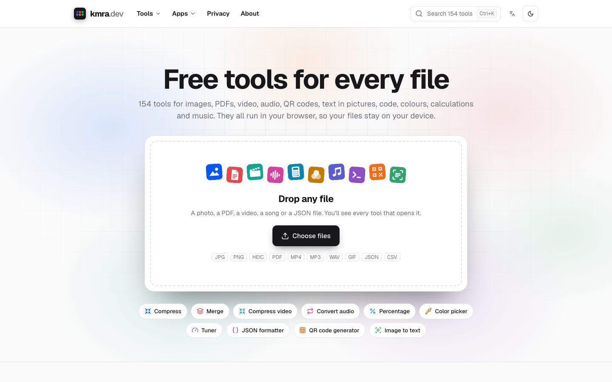

</div>

---

## Features

- **Nothing leaves your device** - files are opened, processed and saved inside the browser tab, and every page tells the browser to refuse requests to any other site
- **Ten sites, one place** - images, PDFs, video, audio, QR codes, OCR, developer tools, calculators, colours and music, each on its own subdomain, all reachable from [kmra.dev](https://kmra.dev)
- **Drop anything** - the hub looks at a file and suggests the tools that can open it, then hands it over without uploading
- **Simple first, Advanced when you need it** - a few controls by default; image tools also have a full editor with every tool, a list of changes, undo and redo
- **Batches** - most tools take many files at once, with per-photo changes, progress, and one zip at the end
- **Fast, local engines** - WebCodecs and ffmpeg.wasm for video and audio, AI models for backgrounds, faces and text, all running on your device
- **Works offline** - once a site has been opened, it keeps working without a connection
- **Two languages** - every site in English and Bangla
- **Free, no account** - no limits, no watermarks, no sign-up, no cookies

---

## The sites

| Site                                    | What it does                                                                         | Tools |
| --------------------------------------- | ------------------------------------------------------------------------------------ | ----: |
| [ImgTool](https://imgtool.kmra.dev)     | Compress, resize, convert, crop, remove backgrounds, passport photos, strip metadata |    30 |
| [PDFTool](https://pdftool.kmra.dev)     | Merge, split, compress, sign, rotate, PDF to images and back                         |    14 |
| [VidTool](https://vidtool.kmra.dev)     | Compress, convert, trim, video to GIF or MP3, screen recorder                        |    14 |
| [AudioTool](https://audiotool.kmra.dev) | Convert, trim, join, volume, speed and pitch, voice recorder                         |    15 |
| [QRTool](https://qrtool.kmra.dev)       | QR codes for links, Wi-Fi, contacts and payments; barcodes; scanners                 |     9 |
| [OCRTool](https://ocrtool.kmra.dev)     | Text from images, screenshots and scanned PDFs; searchable PDFs; 40+ languages       |     4 |
| [DevTool](https://devtool.kmra.dev)     | JSON, YAML, CSV, Base64, JWT, hashes, regex, diff, timestamps and more               |    34 |
| [CalcTool](https://calctool.kmra.dev)   | Scientific calculator, percentages, loans, dates, units, time zones                  |    17 |
| [ColorTool](https://colortool.kmra.dev) | Picker and converter, palettes, gradients, contrast, colour blindness                |     8 |
| [MusicTool](https://musictool.kmra.dev) | Tuner, metronome, beat maker, chords and scales                                      |     9 |

Every tool, with a link, is on the [wiki](https://github.com/ahmmedrejowan/kmra.dev/wiki/Sites-and-tools).

---

## Screenshots

| The image editor                                                              | Compress to a size                                                                |
| ----------------------------------------------------------------------------- | --------------------------------------------------------------------------------- |
| 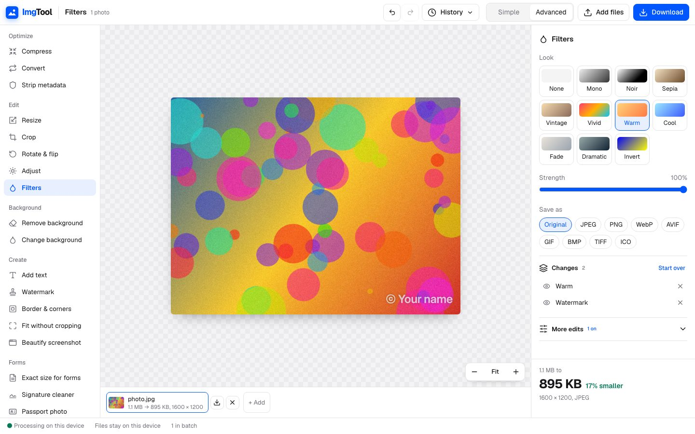 | 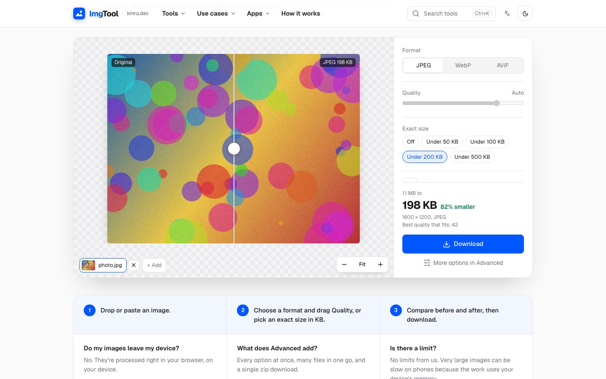 |

| Merge PDFs                                                | Compress a video                                                  |
| --------------------------------------------------------- | ----------------------------------------------------------------- |
| 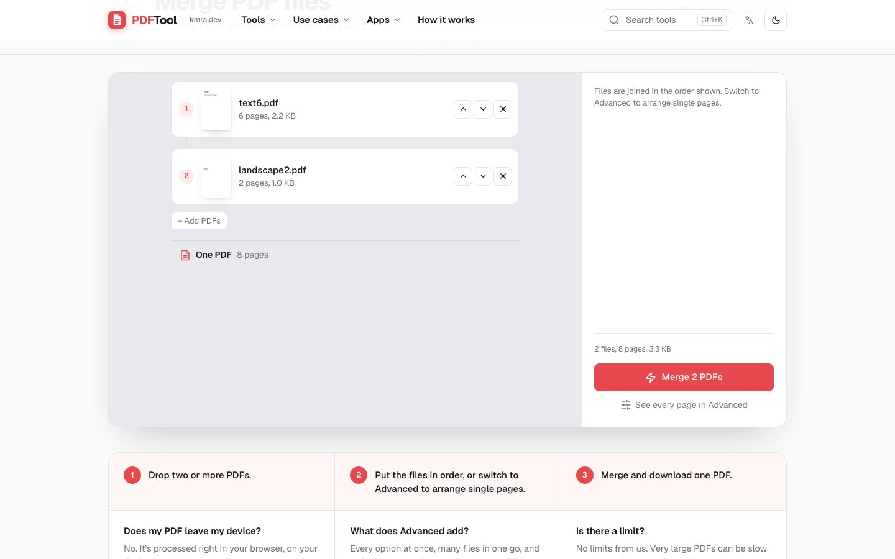 | 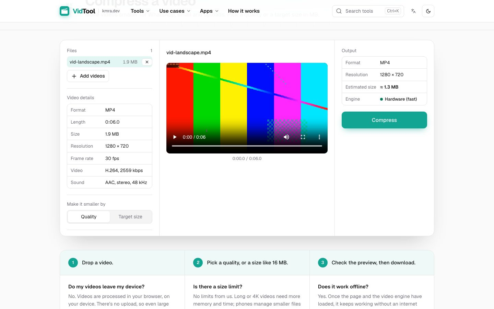 |

| Trim audio                                                               | QR code generator                                            |
| ------------------------------------------------------------------------ | ------------------------------------------------------------ |
| 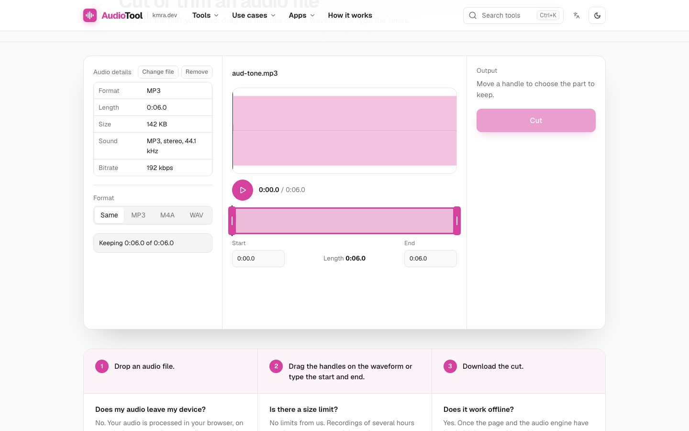 | 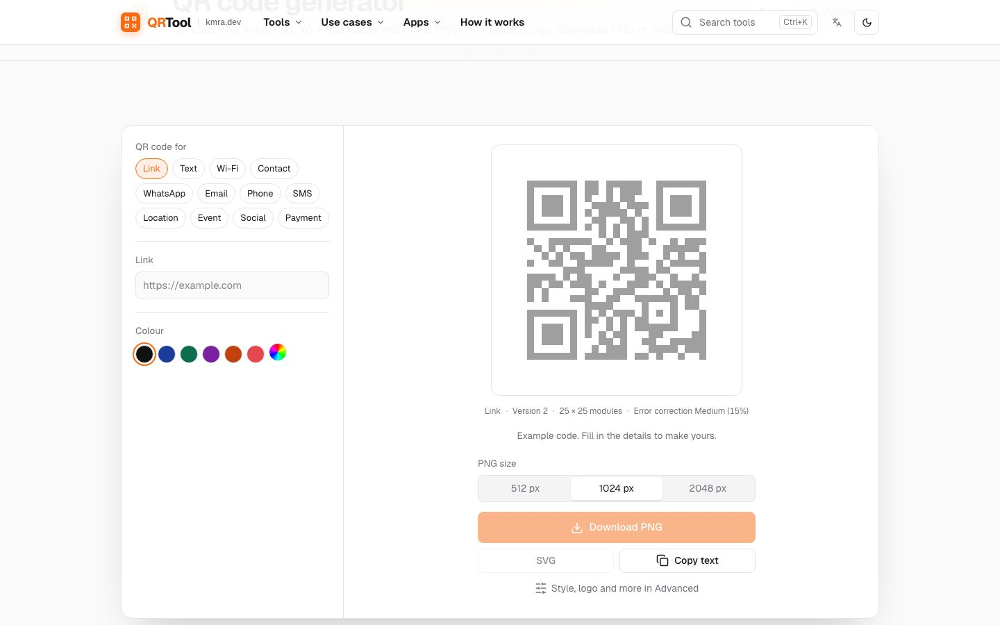 |

| Text from an image                                            | JSON formatter                                                |
| ------------------------------------------------------------- | ------------------------------------------------------------- |
| 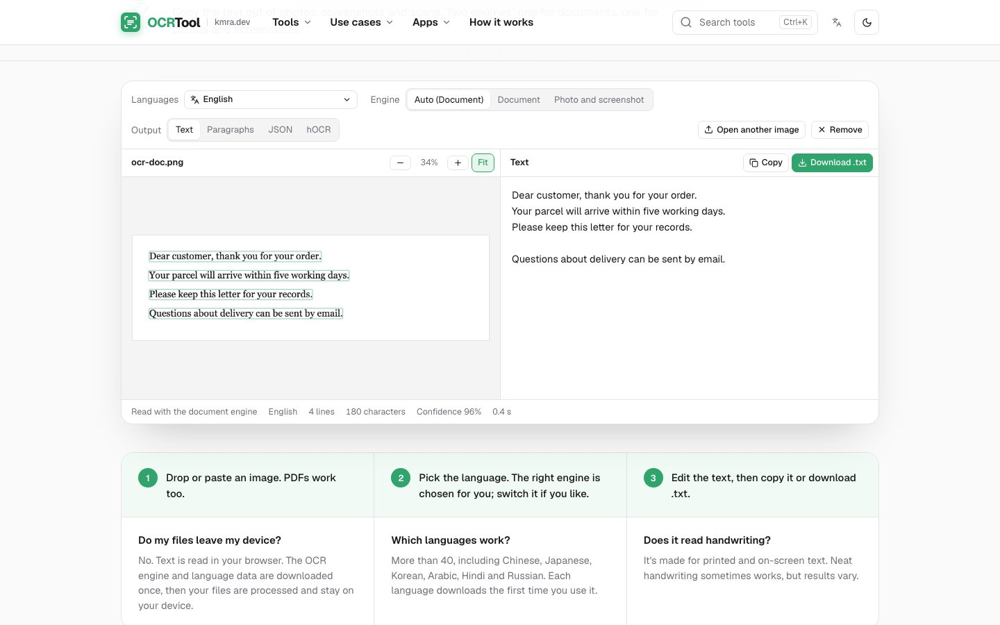 | 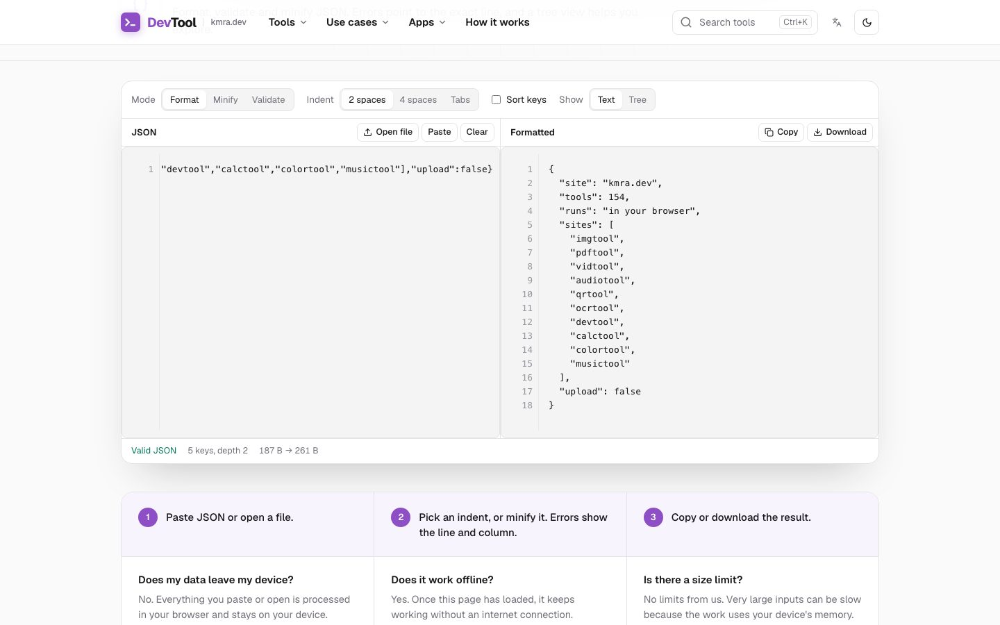 |

| Scientific calculator                                               | Palette generator                                              |
| ------------------------------------------------------------------- | -------------------------------------------------------------- |
| 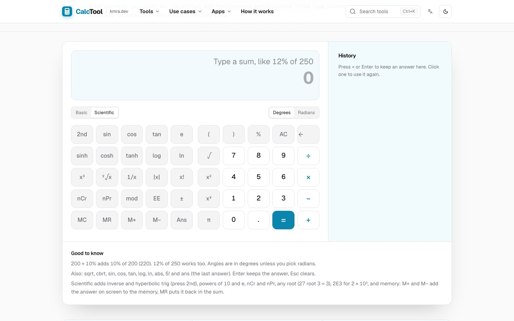 | 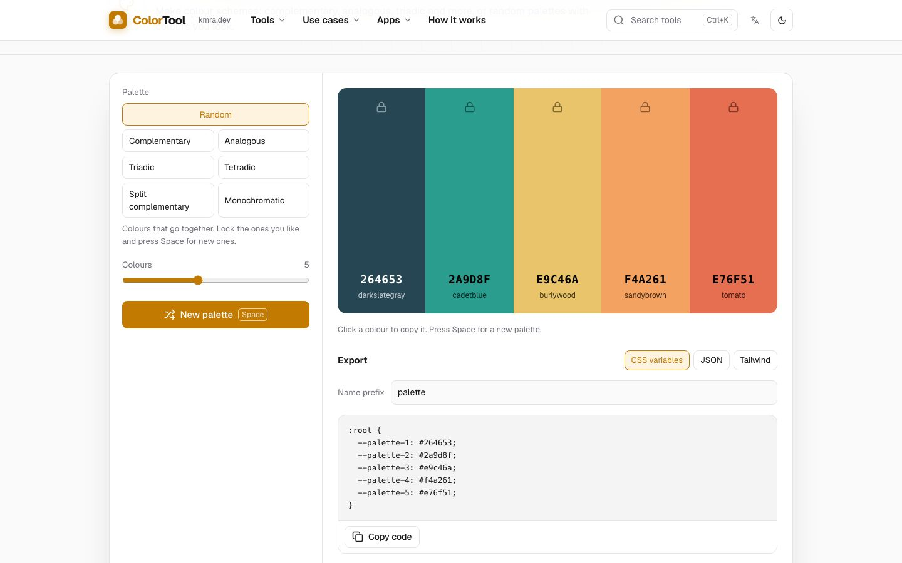 |

| Beat maker                                               | In Bangla                                               |
| -------------------------------------------------------- | ------------------------------------------------------- |
| 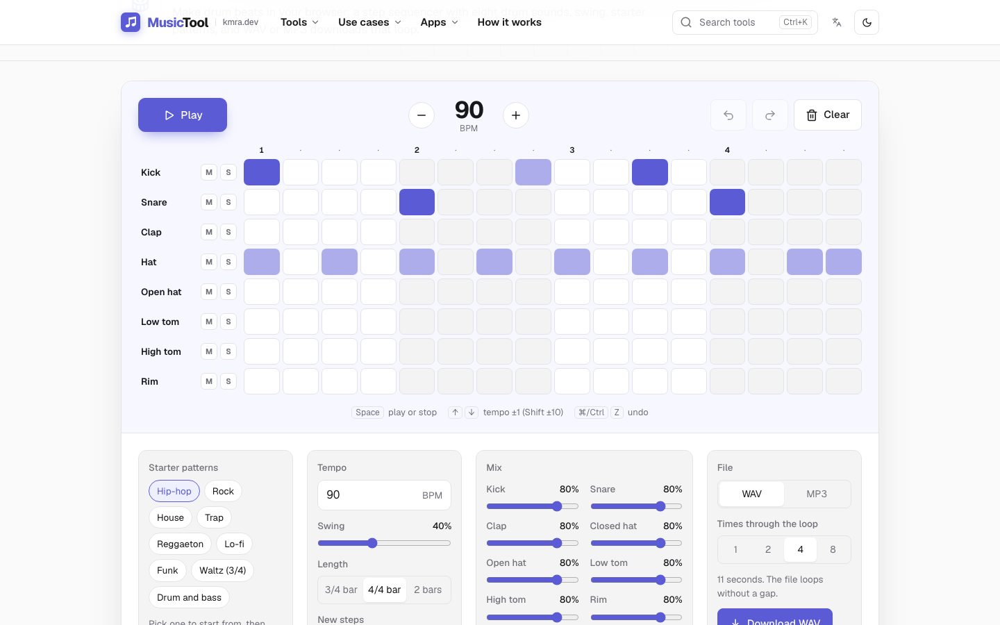 | 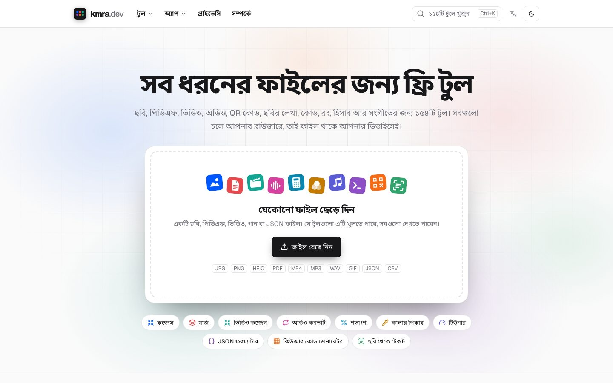 |

---

## Using it

1. **Open a tool.** Go straight to one (for example [imgtool.kmra.dev/compress](https://imgtool.kmra.dev/compress)),
   or drop a file on [kmra.dev](https://kmra.dev) and pick from what fits.
2. **Add your files.** Drop them, paste them, or choose them. Several at once is fine.
3. **Pick a setting or two.** The result updates as you go, with its size and a before/after view
   where the look changes.
4. **Download.** One file, or everything as a zip. Names say what was done:
   `photo-compress-kmra.jpg`.

Need more control? Switch to **Advanced** for the full editor. The [wiki](https://github.com/ahmmedrejowan/kmra.dev/wiki)
explains Simple and Advanced, batches, privacy and offline use.

---

## Architecture

Static sites, shared packages, and engines that run in the browser:

```
apps/
├── kmra/                     # kmra.dev, the hub: every site, a drop box for any file, search
├── imgtool/                  # One Astro site per subdomain, each with the same pages:
├── pdftool/                  #   home, a page per tool and per landing page, all tools,
├── vidtool/                  #   use cases, how it works, privacy, about
├── audiotool/
├── qrtool/
├── ocrtool/
├── devtool/
├── calctool/
├── colortool/
└── musictool/

packages/
├── registry/                 # Every site, tool and landing page; links between sites
├── ui/                       # Layout, header, footer, components, styles, translations
├── media/                    # The video and audio engine: WebCodecs, ffmpeg.wasm fallback
└── config/                   # Security headers, Content Security Policy, caching

tests/                        # Playwright, against the built sites with production headers
docs/                         # How it works, how to develop, test and deploy
```

**How it fits together.** The registry is the single list of what exists: menus, home pages, the
⌘K search, sitemaps, social preview images and links between sites are all generated from it, and
a tool appears only once it's marked ready. Each site builds to plain files; the interactive parts
are React islands that load their heavy engines (WASM codecs, ffmpeg.wasm, pdf.js, AI runtimes)
only on the page that needs them, and run the work in Web Workers.

**Files never travel.** Within a site, a file is kept for a moment in the browser's own storage
for the page it's meant for. From the hub to another site, the file goes through a hidden frame
and `postMessage`, from one tab's memory to the other site's storage in the same browser. The
Content Security Policy (`connect-src 'self'`) makes any other route impossible, and the tests run
with it switched on. [docs/privacy.md](docs/privacy.md) has the details.

### Tech stack

- **Framework**: Astro 7, static output, with React 19 islands
- **Language**: TypeScript, strict
- **Styling**: Tailwind CSS 4 and shared design tokens, light and dark
- **Images**: canvas, jSquash (AVIF), libheif (HEIC), hand-written BMP, TIFF and ICO encoders
- **Video and audio**: WebCodecs through Mediabunny, ffmpeg.wasm as the fallback
- **PDF**: pdf.js to read and draw, pdf-lib to build
- **AI**: onnxruntime-web with MODNet, U²-Net and UltraFace; tesseract.js and PaddleOCR for text
- **Codes**: a QR renderer of its own, zxing-wasm for reading and other 2D codes
- **Monorepo**: pnpm workspaces and Turborepo
- **Tests**: Playwright, end to end
- **Hosting**: Vercel, one project per site

---

## Requirements

- **Node**: 22.12 or newer
- **pnpm**: 12, installed on its own (`npm i -g pnpm`); the exact version is pinned in `package.json`
- **Browsers** (for visitors): a recent Chrome or Edge works best; Firefox and Safari open every
  site, with fewer built-in video and audio encoders

---

## Build and run

```bash
git clone https://github.com/ahmmedrejowan/kmra.dev.git
cd kmra.dev
pnpm install
pnpm dev                    # every site at once
pnpm --filter imgtool dev   # one site: http://localhost:4321
pnpm build                  # static sites in apps/*/dist
```

| Site    | Dev URL        |     | Site      | Dev URL        |
| ------- | -------------- | --- | --------- | -------------- |
| hub     | localhost:4320 |     | qrtool    | localhost:4325 |
| imgtool | localhost:4321 |     | ocrtool   | localhost:4326 |
| pdftool | localhost:4322 |     | audiotool | localhost:4327 |
| vidtool | localhost:4323 |     | calctool  | localhost:4328 |
| devtool | localhost:4324 |     | colortool | localhost:4329 |
|         |                |     | musictool | localhost:4330 |

Adding a tool, a landing page, a language or a whole site is in
[docs/development.md](docs/development.md). Hosting your own copy is in
[docs/deployment.md](docs/deployment.md).

## Testing

```bash
pnpm check           # type checks across the repo
pnpm test:e2e        # build every site, then test every tool in a real browser
pnpm test:e2e:only   # the tests, on the builds you have
```

Around 740 end-to-end tests across the eleven sites. They run against the production builds,
served with the same headers as the live sites, so a tool that tried to reach another host
would fail. They check real output rather than that a page loaded: file types and their bytes,
pixel sizes, page counts, zip contents, QR codes read back, and how damaged or unusual files are
handled.

What they don't cover yet, honestly: they run in Chromium only, they use generated sample files
rather than real photos and recordings, and the depth varies from tool to tool.
[docs/testing.md](docs/testing.md) explains how they work and how to add one.

---

## What's next

No dates, and none of this is a promise:

- **Tests in Firefox and Safari**, and deeper tests for every control of every tool
- **More languages** beyond English and Bangla
- **More tools** where people ask for them

The real list is the issues: ideas go under
[the `idea` label](https://github.com/ahmmedrejowan/kmra.dev/issues?q=is%3Aissue+label%3Aidea).
What gets built is mostly what people ask for.

---

## Contributing

Contributions are welcome. [CONTRIBUTING.md](CONTRIBUTING.md) explains what a change should look
like; open an issue first if it's more than a small fix.

1. Fork the repository
2. Branch off `main`
3. `pnpm check && pnpm test:e2e`
4. Commit, push, and open a pull request

Every tool runs in the browser and never contacts another host; a change that needs a server
should start as an issue.

---

## License

```
Copyright (C) 2026 K M Rejowan Ahmmed

This program is free software: you can redistribute it and/or modify
it under the terms of the GNU Affero General Public License as published
by the Free Software Foundation, version 3.

This program is distributed in the hope that it will be useful,
but WITHOUT ANY WARRANTY; without even the implied warranty of
MERCHANTABILITY or FITNESS FOR A PARTICULAR PURPOSE. See the
GNU Affero General Public License for more details.
```

> **Note**
> This is a copyleft license, and it covers running the sites too: if you run a changed copy for
> others, you share its source the same way.

Third-party code, AI models and fonts keep their own licenses, listed in
[THIRD_PARTY_NOTICES.md](THIRD_PARTY_NOTICES.md). The kmra.dev name and logos aren't covered by
the license: please use your own for a copy you run.

---

## Community

- [Discussions](https://github.com/ahmmedrejowan/kmra.dev/discussions) - ask anything, share ideas
- [Issues](https://github.com/ahmmedrejowan/kmra.dev/issues) - something wrong, or an idea
- [Support](SUPPORT.md) - where to go for what
- [Wiki](https://github.com/ahmmedrejowan/kmra.dev/wiki) - how to use the sites
- [Security](SECURITY.md) - please report privately rather than opening an issue
- [Privacy](docs/privacy.md) - how files stay on your device

---

## Author

**K M Rejowan Ahmmed**

- Website: [rejowan.com](https://rejowan.com)
- GitHub: [@ahmmedrejowan](https://github.com/ahmmedrejowan)
- Email: [ping@kmra.dev](mailto:ping@kmra.dev)

---

## Acknowledgments

- [Astro](https://astro.build/) and [React](https://react.dev/) - the sites and their interactive parts
- [Mediabunny](https://github.com/Vanilagy/mediabunny) and [ffmpeg.wasm](https://github.com/ffmpegwasm/ffmpeg.wasm) - video and audio in the browser
- [pdf.js](https://mozilla.github.io/pdf.js/) and [pdf-lib](https://pdf-lib.js.org/) - reading and building PDFs
- [onnxruntime-web](https://onnxruntime.ai/) - running the AI models
- [MODNet](https://github.com/ZHKKKe/MODNet), [U²-Net](https://github.com/xuebinqin/U-2-Net) and [UltraFace](https://github.com/Linzaer/Ultra-Light-Fast-Generic-Face-Detector-1MB) - backgrounds and faces
- [Tesseract](https://github.com/tesseract-ocr/tesseract), [tesseract.js](https://github.com/naptha/tesseract.js) and [PaddleOCR](https://github.com/PaddlePaddle/PaddleOCR) - reading text
- [zxing-wasm](https://github.com/Sec-ant/zxing-wasm) - reading barcodes
- [Geist](https://vercel.com/font) - the typeface
